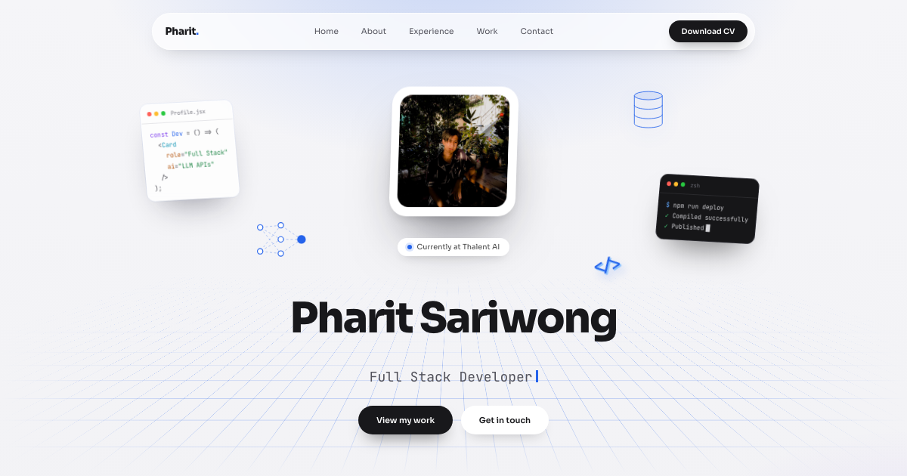

# Pharit Sariwong — Portfolio

Personal portfolio of Pharit Sariwong, Full Stack Developer.

**Live:** https://pharit01.github.io/my-portfolio/



## Features

- Single-page portfolio: hero, stats, about & skills, experience, selected work, contact
- "Soft 3D" design: tilting profile card, perspective grid floor, floating dev objects with mouse parallax
- Responsive layout with a mobile hamburger menu
- Downloadable CV
- [Pokémon API Explorer](https://pharit01.github.io/my-portfolio/#/Pokemons): a side project to search Pokémon and battle them, using [PokéAPI](https://pokeapi.co/)

## Tech stack

- React 19 + React Router (`HashRouter`, so routes work on GitHub Pages)
- Plain CSS (`src/styles/portfolio.css`), no UI framework
- Create React App (`react-scripts`)
- Deployed to GitHub Pages with `gh-pages`

## Getting started

```bash
npm install
npm start
```

The dev server runs at http://localhost:3000.

## Scripts

| Command          | What it does                                             |
| ---------------- | -------------------------------------------------------- |
| `npm start`      | Run the dev server                                       |
| `npm run build`  | Production build into `build/` (not committed)           |
| `npm test`       | Run tests                                                |
| `npm run deploy` | Build and publish `build/` to the `gh-pages` branch      |

## Project structure

```
src/
  App.js                 Portfolio page (section order)
  index.js               Router: "/" portfolio, "/Pokemons" side project
  component/             Nav, Hero, Stats, About, Experience, Work, Contact
  component/Poke/        Pokémon API Explorer
  hooks/                 useTilt, useParallax, useTypewriter
  utils/                 scrollToSection
  styles/portfolio.css   All portfolio styles and responsive breakpoints
  assets/                Profile photo, project screenshots, Resume.pdf
public/                  index.html (meta/Open Graph tags), favicon, manifest
```

## Updating content

- **Experience:** `EXPERIENCE` in `src/component/Experience.js`
- **Skills and About text:** `src/component/About.js`
- **Projects:** `PROJECTS` in `src/component/Work.js`
- **CV:** replace `src/assets/Resume.pdf`

## Contact

pharitsariwong@gmail.com · [github.com/pharit01](https://github.com/pharit01)
